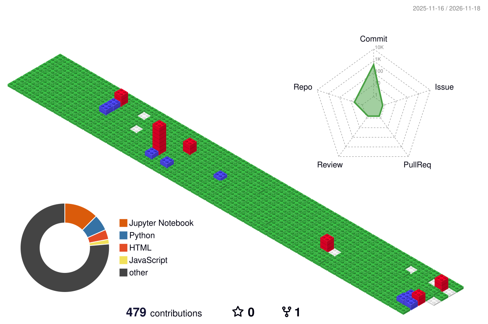

    

 

<h3 align="center">🥯 Interests </h3>

  &nbsp
  &nbsp

  &nbsp
  &nbsp
  &nbsp

 

<h3 align="center">🥐 Tech Stack </h3>

  &nbsp
  &nbsp
  &nbsp

  &nbsp
  &nbsp

 

<h3 align="center">🥞 Tools </h3>

  &nbsp
  &nbsp
  &nbsp

  &nbsp
  &nbsp

 

<h3 align="center">🥨 Contact </h3>

  <a href="mailto:cxyz.kim@gmail.com">
    &nbsp
  </a>

  
  

 

